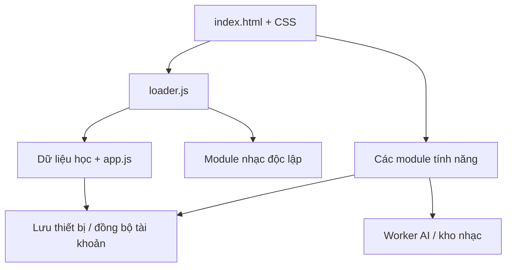

# Cơ chế app HSK — Hướng dẫn thao tác an toàn cho AI

Đối chiếu mã nguồn tại commit `68968ee` ngày 27/10/2026, bản PWA **3.20.9**. Đây là bản đồ thao tác, không phải bằng chứng rằng mọi dịch vụ live đã được kiểm tra. Khi code thay đổi, đối chiếu lại trước khi dùng lệnh. Ghi chú phiên bản cũ trong tài liệu khác có thể đã hết hiệu lực.

## 1. Đọc trước khi sửa

1. Đọc `AGENTS.md`, tài liệu này, `docs/ai/FEATURE_PRESERVATION.md` và mục liên quan trong `tools/feature-contract.json`.
2. Chạy `git status -sb`, `git branch --show-current`, `git log -1 --oneline`, `git fetch origin main`. Không reset/ghi đè checkout đang có thay đổi. Nếu cần, tạo worktree riêng từ `origin/main`.
3. Khi tiếp tục việc cũ, đọc `docs/ai/TASK_STATE.md`. Tra `docs/ai/PROJECT_MAP.md` đúng tính năng; phần lịch sử không thay thế code thực tế.
4. Xác định yêu cầu sửa UI, nội dung, dữ liệu, backend hay triển khai. Không deploy backend để sửa giao diện.
5. Tạo nhánh riêng; sửa tối thiểu; kiểm tra; commit; mở PR. Chỉ merge/deploy khi chủ dự án cho phép.

Nguồn chính: https://github.com/trungxemcode/hsk, nhánh `main`. Trên máy chủ dự án, `C:\Users\LENOVO\hsk` là checkout ưu tiên; vẫn phải kiểm tra branch/trạng thái thực tế. Không coi thư mục cũ `C:\New folder\hsk` là một app độc lập.

## 2. App này là gì, không được suy đoán là gì

Đây là web tĩnh HTML/CSS/JavaScript thuần, có PWA/service worker, backend Cloudflare và tài khoản Firebase. Không có bước build frontend React/Vite/npm thông thường. Không tự thêm framework hay chuyển toàn bộ sang ES modules để sửa một lỗi nhỏ.

Trên điện thoại hiện dùng cùng web app với layout responsive và chế độ cài màn hình chính. Repository hiện không có dự án native iOS/Android hoặc cấu hình Capacitor. Không mô tả PWA như file IPA/APK đã được tạo.



## 3. Luồng khởi động và điểm cắm

| Điểm | Chủ sở hữu / nhiệm vụ | Quy tắc khi nối code |
|---|---|---|
| `index.html` | DOM chính, các panel, CSS, classic scripts | Giữ ID, thứ tự script và đường dẫn gốc; CSS có cascade nhiều lớp |
| `loader.js` | Tải dữ liệu và nhạc độc lập; chẩn đoán tải | Không để lỗi nhạc chặn dữ liệu học hoặc ngược lại |
| `content/data/` | 10 gói: words, dictionarySupplement, checkedPracticeExamples, exampleMetadata, wordRelationsData, usageFactsData, confusableGroups, contextQuizBank, visualConfusions, hskConfusionIndex | Mỗi gói có JS và gzip; bản thường là fallback, không phải bản thừa |
| `src/utils/text.js`, `src/utils/format.js`, dictionary core/search, `src/ui/dictionary-relations.js` | Helper dùng trước `app.js` | Không đổi thứ tự hoặc tự bọc scope; các classic script chia sẻ binding |
| `app.js` | Trạng thái học, thẻ, tìm kiếm, chấm và SRS hiện hữu | Không tạo nguồn tiến độ/SRS thứ hai trong lớp UI |
| `src/modules/shell/studio.js` | Điều hướng, hub/panel, `HSKStudio`, công cụ tìm kiếm | Dùng route có sẵn qua `HSKStudio.navigate(...)`; không chỉ đổi class rồi bỏ lifecycle |
| `src/modules/shell/mobile-ux.js` | Chuyển DOM responsive, sheet, focus học, loading | Không clone nút có handler; giữ vị trí phục hồi desktop, focus/scroll |
| `src/modules/shell/home-overview.js` | Trang chủ, từ vựng/ngày, tiến độ, CTA | Chỉ trình bày tiến độ thật; không tự thưởng điểm khi xem/nghe từ |
| `redesign.css`, `style.css`, `studio-layout.css`, `mobile-ux.css`, `ui-buttons.css` | Token, layout và lớp giao diện | Kiểm tra selector thắng thực tế; dùng token hiện có, tránh chồng override vô hạn |

Loader ưu tiên `DecompressionStream` cho `.js.gz`, fallback `.js` nếu API/file nén không dùng được. Helper → `app.js` → các cầu nối phải đúng thứ tự. Nhạc có `HSKMusicLoad.start()`, promise tải dùng chung và retry; không buộc người dùng chờ toàn bộ kho từ mới nghe nhạc.

Các event cần tra tại nơi phát/lắng nghe: `hsk-lessons-ready`, `hsk-account-ready`, `hsk-plan-change`, `hsk-flashcard-change`, `hsk-music-ready`, `hsk-chinese-voice-change`. Chúng không bảo đảm cùng thời điểm. Kiểm tra module đã sẵn sàng, hủy listener/tác vụ khi không còn hợp lệ; không giả lập event để vượt kiểm tra.

## 4. Bản đồ tính năng và ranh giới dữ liệu

| Tính năng | File/thư mục cần xem đầu tiên | Không làm hỏng |
|---|---|---|
| Bài học | `src/modules/lessons/`, `lessons-data.json`, `lesson-content-hsk*.json` | ID bài/từ, ví dụ, bằng chứng hoàn thành, đọc và grading |
| Mục tiêu/lịch học | `src/modules/planner/`, placement | Mục tiêu học khác bộ lọc tìm từ; kết quả đánh giá không tự chứng minh thuộc từ |
| Luyện tập/SRS | `app.js`, `src/modules/practice/` | Lịch đến hạn, điểm, lỗi sai, tập từ thật đang chọn |
| Đề thi | `src/modules/exams/`, `content/drive-hsk/`, Drive audio/exam manifests | Câu hỏi, đáp án, ảnh/audio, thời gian và kết quả |
| Tra cứu/viết tay | `src/modules/dictionary/`, `src/modules/handwriting/`, `handwriting-worker.js` | Phân biệt nhận dạng offline, model tải tùy chọn và AI online |
| Dịch/OCR/chat bài học | `src/modules/translation/` | Auth, hủy yêu cầu, context và trạng thái loading thực |
| Đọc AI/coach | `src/modules/reading/`, `src/modules/ai-coach/` | Schema kết quả, lịch sử/cache theo scope, bài/cấp HSK |
| Sổ từ vựng | `src/modules/notebook/` | CRUD, dữ liệu cá nhân, nút lưu không tự ghi mastery |
| Tài khoản/đồng bộ | `src/modules/account/`, `firestore.rules`, `firebase.json` | Phân vùng UID, guest, tiến độ offline, merge và logout |
| Sao lưu | `src/modules/backup/` | Schema/validation, nhập lại, chống ghi chéo tài khoản |
| Học rảnh tay | `src/modules/passive/`, speech | Queue theo tập từ, pause/stop, hủy giọng khi đổi phiên |
| Giọng đọc | `src/modules/speech/` | Giọng thiết bị, Yunjian tùy chọn, hủy/race và rollback tải |
| Dọn bộ nhớ | `src/modules/shell/storage-cleanup.js` | Chỉ xóa download tùy chọn được cho phép; không xóa tiến độ/app cache bừa bãi |

Các tên `window.HSK...` là API hiện hữu, không phải lời mời gọi bất kỳ hàm nội bộ nào. Tra nơi export để biết chữ ký thật: `HSKStudio`, `HSKLessons`, `HSKLessonNav`, `HSKPlanner`, `HSKStudyStore`, `HSKSpeech`, `HSKVoiceManager`, `HSKMusic`, `HSKAccountBackup`, `HSKSearchTools`. Giữ API công khai và các consumer khi refactor.

### Lưu trữ và async

- Tiến độ hiện có gồm các khóa như `hsk-flashcards-progress-v1`, `hsk-flashcards-mistakes-v1`, `hsk-memory-preferences-v1`. Đây là ví dụ, không phải danh sách đầy đủ: tìm mọi consumer trước khi sửa khóa/schema.
- Không đổi ID từ/bài, khóa localStorage, database/store IndexedDB hoặc Firestore chỉ để “làm sạch”. Migration phải có fallback, thử dữ liệu cũ và khả năng phục hồi.
- Guest và tài khoản là hai scope; phản hồi tới muộn sau logout/đổi UID không được ghi vào scope mới. Giữ các serial/revision/token kiểm tra yêu cầu hiện tại.
- Không xóa toàn bộ localStorage/IndexedDB/cache để sửa một UI bug. Không đưa dữ liệu thật của người học vào fixture/test.
- Không để tác vụ AI lỗi làm mất nội dung trước đó. Chỉ ghi cache/kết quả sau validation và kiểm tra yêu cầu còn hợp lệ.

## 5. Cơ chế nhạc hiện tại

`loader.js` tải music core, lyrics core, transcript, lyrics UI, SoundCloud adapter, legacy cleanup rồi `music.js`. `music-config.json.cloudEndpoint` chỉ kho nhạc R2; `enabled:false` cùng `endpoint:""` không đồng nghĩa phải tắt kho R2.

Nhạc giải trí hiện phát audio công khai từ kho R2. Người nghe có thể lưu ngữ cảnh link/playlist cá nhân; không tự biến một link chưa nhập kho thành luồng YouTube nền. Nhập YouTube của chủ kho đi qua hàng đợi Worker → GitHub Actions → `tools/music-import-runner.py` → audio nhập R2. Giữ tách biệt quyền gửi link cá nhân với quyền xuất bản/xóa kho.

| Phần | Điểm cắm | Ràng buộc |
|---|---|---|
| UI/playback | `src/modules/music/music.js` | Giữ singleton audio, lifecycle và ý định phát; không remount audio khi đổi route hoặc redraw |
| R2 server | `server/music/cloud-worker.mjs`, `import-jobs.mjs`, `youtube-search.mjs` | Firebase owner xác thực ở server; client ẩn nút không đủ bảo mật |
| HTTP audio | Native MP3/M4A, Range/HEAD/ETag | Không đổi thành tải toàn bộ Blob hoặc iframe để sửa lỗi giao diện |
| Nghe tiếp | Cache bài/vị trí gần nhất trên thiết bị trong `music.js` | Không biến thành đồng bộ toàn bộ lịch sử; không autoplay không có thao tác người dùng |
| Lời bài hát | `music-lyrics-core.js`, `music-lyrics-ui.js`, `music-transcript.js` | Giữ LRC/SRT/JSON timestamp, read-only người nghe và quyền chủ kho |
| AI transcript | Route `/music-transcript`, flag `MUSIC_TRANSCRIPT_ENABLED=false` trong config repo | Đang tắt; không tự bật lại. Script thủ công vẫn được dùng |
| File cũ trên máy | `legacy-music-cleanup.js`, storage cleanup | Không tự xóa dữ liệu người dùng còn giữ chỉ vì bỏ tính năng cũ |

Chú ý các hàm `mountCloudAudio`, `syncBackgroundPlayer`, `syncMediaSession`, `requestLinkPlayback`: trước khi sửa phải đọc consumer, test native AAC và route lifecycle. Không dùng silent keepalive/iframe giả để tuyên bố hỗ trợ khóa màn hình. Mô phỏng `document.hidden` không chứng minh phát nền trên iPhone thật.

## 6. Giọng đọc và tài nguyên lớn

`voice-catalog.json` hiện chỉ cung cấp gói Kokoro Nam Yunjian. Model/voice tải theo yêu cầu, kiểm bytes/hash, dùng local worker/IndexedDB; không nhét model khoảng 94 MiB của lần cài đầu vào PWA cache mặc định. `voice-manager.js`, store, pack worker và model transport chịu trách nhiệm tải/khởi tạo/đổi giọng an toàn.

Giữ gói đang chạy cho tới khi gói thay thế tải/kiểm tra thành công. Không thay bằng gói nhỏ hơn nếu chưa chứng minh chất lượng và runtime tương thích. Các notice giấy phép và provenance phải giữ. Công cụ chuẩn bị Huayan lịch sử không phải quy trình tạo catalog Yunjian hiện tại; không chạy mù các script tái dựng.

Chín file cũ đã bị xóa qua PR217, gồm `index_mobile.html` và tám demo giọng khác. Không phục hồi chỉ để làm một script lịch sử chạy được nếu chưa có yêu cầu thay đổi giọng.

## 7. Backend, AI và triển khai: ba đường độc lập

| Đường | Cấu hình / đầu vào | Quy tắc |
|---|---|---|
| Web/PWA | GitHub Pages từ repository, `app-version.json` | Merge không đồng nghĩa đã kiểm tra web live; xác minh artifact/live version |
| AI/voice Worker | `server/wrangler.jsonc` → `translator-worker-bundled.mjs`; nguồn `translator-worker.mjs` và module server | Build bundle đúng nguồn, kiểm tra chênh lệch với live trước deploy |
| Kho nhạc R2 | `server/music/wrangler-cloud.jsonc` → `cloud-worker.mjs` | Bucket/bindings/quyền riêng; không dùng config pilot thay thế |

`server/music/wrangler.jsonc` là pilot có D1 placeholder, không phải config kho R2 hiện tại. `firebase.json` triển khai Firestore rules riêng, không phải lệnh cập nhật frontend.

AI frontend lấy endpoint từ `translation-config.json`. Các route gồm `/translate`, `/ask`, `/lesson-ask`, `/reading-next`, `/ocr`, `/dictionary-lookup`, `/dictionary-translate`, `/study-plan-review`, `/handwriting-recognize`, `/handwriting-samples`, role/admin và `/voice-precache`. Mỗi route có payload, quota và validator riêng; đọc handler trước khi thêm field/chuyển model.

Vai trò/quota do server xác nhận: admin cố định, VIP và người dùng thường. Không cho client tự khai role để vượt quota. Giữ tách nhà cung cấp theo role/feature, ngân sách, chống spam, ngày Việt Nam, key cooldown và Durable Object `AI_CONTROL`. Secrets đặt bằng cơ chế secret của môi trường; không commit `.env`, token Firebase, cookies YouTube hay API key.

Phân loại lỗi: caller400 cần sửa request; model-access/404 cần kiểm tra model/quyền; auth401/403 cần sửa phiên/quyền; quota429 giữ Retry-After/cooldown; transient503 chỉ retry có giới hạn. Không retry vô hạn, không xóa cooldown để ép chạy, không âm thầm chuyển provider trái chính sách. Luồng voice không được coi là text fallback thông thường.

**Cảnh báo đã có trong dự án:** source Worker voice live từng có bản vá độc lập chưa đồng nhất bundle GitHub. Trước deploy phải lấy/đối chiếu source và bindings live bằng công cụ được phép, lập diff và giữ voice patches. Không deploy canonical bundle đè lên live chỉ vì bài test local đạt. `docs/ai/TASK_STATE.md` ghi bối cảnh, không bảo đảm trạng thái live hôm nay.

Các lệnh dưới chỉ dùng sau khi xác minh đúng đích và được phép deploy:

```sh
node tools/build-worker-bundle.cjs
node --test server/*.test.mjs
npx wrangler deploy --config server/wrangler.jsonc
# Hoặc chỉ kho nhạc, khi yêu cầu thuộc kho nhạc:
npx wrangler deploy --config server/music/wrangler-cloud.jsonc
```

Không chạy cả hai deploy theo thói quen. Apps Script trong `tools/voice-cache-apps-script/` là pipeline riêng. Không bật Auto50, trigger, cron hay gửi báo cáo/mail chỉ vì sửa app; người dùng đã yêu cầu dừng auto.

## 8. Web sang iOS/Android: chuẩn hiện tại

“Chuyển sang điện thoại” hiện là phục vụ HTTPS + responsive + manifest + service worker, rồi người dùng cài PWA bằng chức năng của trình duyệt. Không đổi đuôi HTML thành IPA/APK. Chức năng/thao tác cài và quyền phụ thuộc trình duyệt/OS; kiểm tra trên thiết bị thật thay vì chỉ user-agent.

- `manifest.webmanifest`: `id`, `start_url`, `scope` dùng `./`, display standalone. Giữ toàn bộ cây `/hsk/` khi host ở subpath; kiểm tra relative URL, worker/importScripts, fonts, fetch và icons.
- iOS: kiểm tra cả Safari tab và PWA màn hình chính; safe-area trên/dưới, notch khi xoay ngang, bàn phím và viewport khi mở chat. Input phải tránh kích hoạt zoom ngoài ý muốn; nút tối thiểu khoảng44px, chữ không sát biên.
- Android: kiểm tra Chrome tab/PWA, nút Back, bàn phím, viewport và lifecycle khi ra nền. Không suy ra Android đúng chỉ từ Safari hoặc ngược lại.
- Audio cần gesture thật; sau reload có thể hiển thị trạng thái nghe tiếp nhưng không được giả định tự phát thành công. MediaSession điều khiển không thay thế giấy phép playback của OS.
- Push: `push.js`, `push-config.json`, `OneSignalSDKWorker.js`, workflow nhắc ôn. Giữ scope và worker integration hiện có; không đăng ký worker cạnh tranh chiếm scope.
- Nếu sau này yêu cầu APK/IPA bằng wrapper: đó là dự án mới cần đánh giá riêng (origin, CORS/Firebase redirect, storage migration, native audio/push, ký/phát hành). Không tự thêm wrapper vào nhiệm vụ UI; không hứa WebView mặc nhiên giải quyết âm thanh nền.

### Hiệu năng và animation

Không tắt mọi animation để che lỗi. Giữ `prefers-reduced-motion`; ưu tiên opacity/transform khi phù hợp. Gom touchmove/scroll bằng requestAnimationFrame, đọc geometry rồi ghi style theo batch; tránh forced layout để reset animation. Không thêm translateZ/will-change toàn trang vì có thể đổi containing block của fixed/sticky và tăng bộ nhớ.

MutationObserver phải có scope và thao tác idempotent: không gán lại hidden/text/class vô ích gây vòng cập nhật. Đồng hồ nhạc không quét toàn app. Hủy/kiểm tra callback khi document đã đóng. Tránh blur nhiều lớp hoặc ảnh full-size quá lớn trong animation mà chưa đo. Test Chromium touch viewport là kiểm tra hành vi, không phải số FPS Safari/iPhone thật.

## 9. PWA, nội dung và quy chuẩn phát hành

Nguồn danh mục: `tools/pwa-assets.json`, aliases URL cũ và `tools/pwa_assets.py`. `app-version.json`, `offline-worker.js`, `offline.js`, `OneSignalSDKWorker.js` phải đồng bộ qua công cụ, không sửa hash bằng tay. Dữ liệu derived (Drive/audio/ảnh) có chính sách chọn lọc, không cache toàn corpus bừa bãi.

Sau sửa frontend/config/nội dung hoặc xóa file frontend cũ, trước commit:

```sh
python tools/prepare-pwa-release.py --note "Mô tả ngắn bằng tiếng Việt"
# Tính năng lớn dùng thêm --bump minor; sửa/cải tiến nhỏ dùng patch mặc định.
git add app-version.json offline.js offline-worker.js OneSignalSDKWorker.js
```

Giữ major3 đến khi chủ dự án đổi quy tắc. Nhãn `Bản X.Y.Z (Nội dung cập nhật)`. Sau commit chạy release guard với base; kiểm tra trên diff đã commit, vì chỉ nhìn working tree/staged có thể bỏ sót việc cần tăng bản. Tài liệu thuần không tăng bản; backend-only không tải lại PWA.

Không làm mới toàn cache, không activate/reload cưỡng bức giữa bài làm hoặc lúc phát nhạc. Test cập nhật có cache cũ, offline reload, reuse asset/hash và giữ tiến độ. Post-merge phải xác nhận GitHub Pages đã có manifest/version và asset đúng; “merged”, “deployed”, “verified trên iPhone” là ba trạng thái khác nhau.

## 10. Bộ kiểm tra trước PR và merge

Chạy HTTP server ở root (`python -m http.server 8765`), không kiểm tra bằng file://. Node/Python cần đúng phiên bản theo workflow. Playwright/jsdom là dependency của test, không phải lý do tạo frontend npm build. Khi đặt dependency ngoài repo, trỏ `NODE_PATH`; có thể đặt `CHROME_EXECUTABLE` tới Chrome đã cài. Native AAC cần trình duyệt có codec thực; không mock audio rồi tuyên bố test nền thật.

Tối thiểu theo AGENTS:

```sh
python tools/check-feature-preservation.py --base origin/main
node tools/check-feature-runtime.cjs
python tools/check-pwa-release.py --base origin/main
```

| Sửa gì | Các bài kiểm tra liên quan (chọn đúng phạm vi) |
|---|---|
| Trang chủ/mobile/CSS | check-home-overview-ui, check-mobile-ux-ui, check-redesign-ui, check-studio-ui, check-design-tokens |
| Loading/async | check-ai-loading-ui + lỗi/abort/đổi tài khoản |
| Audio/nhạc | check-music-background-ui, check-music-queue-motion-ui, check-music-menu-ui, check-music-ios-layout, check-music-startup-ui |
| Voice | check-yunjian-only, check-chinese-voices-ui, check-yunjian-model-transport; test model thật nếu đổi runtime/model |
| Chuyển module/URL | check-module-loading-ui, check-pwa-relocation-ui, gzip lỗi/no-api và subpath `/hsk/` |
| Storage/auth | check-storage-cleanup-ui, check-storage-migration-ui, check-backup-relocation-ui + core/server liên quan |
| Server | `node --test server/*.test.mjs`; mock provider đúng scope, không tiêu API thật |

Tên ngắn trong bảng là file `tools/<tên>.cjs`. Tập đầy đủ xem `.github/workflows/feature-preservation.yml`, `studio-ui.yml`, `pwa-release-guard.yml`, `mobile-dock.yml`.

Nếu CI đỏ: đọc job log và lần lỗi đầu, tái hiện, phân biệt lỗi app với giả định test cũ. Đổi test để phản ánh hành vi mới khi đã được yêu cầu, đồng thời giữ/chứng minh guard tương đương; không xóa assert/contract, skip/force thao tác để che nút không dùng được. Ví dụ: chọn nút theo vai trò/selector chức năng, không dùng “button đầu tiên” khi thêm nút mới vào hero.

Xóa tính năng đã được bảo vệ cần PR phê duyệt riêng trong `tools/approved-feature-removals.json`, merged trước PR code. Xóa file dư không đồng nghĩa được phép xóa tính năng. Không tự sửa danh mục để cho phép việc xóa mà chủ dự án chưa duyệt.

## 11. Quy trình làm việc mẫu cho AI tiếp theo

1. Ghi lại commit base, phạm vi yêu cầu, file đích và chức năng phải giữ.
2. Đọc entry → handler → state/storage → server của đúng luồng; dùng `rg` thay vì đọc toàn repo.
3. Tạo nhánh/worktree; sửa nhỏ; giữ IDs/public API; nếu thêm async phải có hủy và chống phản hồi cũ.
4. Chạy bài test hẹp và xem screenshot. Test cả320/390/1440, sáng/tối, portrait/landscape nếu sửa layout; thử đổi route, reload, dữ liệu cũ và lỗi mạng theo phạm vi.
5. Chuẩn bị PWA nếu có client change; commit; chạy guard so với `origin/main`. Không lẫn secrets hoặc thay đổi của người khác.
6. Mở PR mô tả vấn đề → hành vi mới → test và giới hạn. Đọc CI; sửa lỗi liên quan; không tự merge/deploy ngoài quyền đã cấp.
7. Khi được phép merge: kiểm tra SHA head, CI và conflict; dùng expected head để không merge nhầm thay đổi mới. Không force-push `main`.
8. Báo cáo rõ đã sửa gì, kiểm tra nào đạt, PR/commit, đã merge/deploy chưa và thiết bị thật đã kiểm tra chưa. Cập nhật ghi chú liên quan khi cơ chế thay đổi.

### Trước khi rời tác vụ

- Không mất bài đang học, nhạc đang phát hoặc tiến độ đã lưu.
- Không ghi scope của người cũ sau khi đổi tài khoản.
- Không bỏ fallback dữ liệu/worker aliases vì thấy file giống nhau.
- Không đổi quyền/quota/model hoặc bật auto khi yêu cầu chỉ sửa giao diện.
- Không coi checklist này thay thế việc đọc code và kiểm tra thực tế.

## 12. Sổ kết nối máy chủ, URL và dịch vụ ngoài

Các địa chỉ dưới lấy từ code/config ở commit đối chiếu, **không phải kết quả health-check live**. HTTPS URL công khai không phải secret. Tuy nhiên tuyệt đối không chép token, cookies, khóa quản trị hoặc nội dung secret vào tài liệu. Nếu đổi URL phải tìm cả consumer gián tiếp, runner, CORS và PWA; không chỉ sửa một dòng frontend.

| Kết nối / URL | File chứa điểm cắm | Luồng và lưu ý khi đổi |
|---|---|---|
| `https://trungxemcode.github.io/hsk/` | Origin trong cấu hình server; relative URLs trong frontend | Web/PWA; `/hsk/` là subpath cần giữ ở service worker và mọi asset. Origin CORS là `https://trungxemcode.github.io`, không kèm `/hsk/` |
| `https://hsk-vietnamese-translator.trung-hsk668.workers.dev/translate` | `translation-config.json` | Điểm vào AI/dịch; module có thể dựng route khác từ cùng origin. Đối chiếu handler từng route ở mục7, giữ auth/payload |
| `https://hsk-music-library.trung-hsk668.workers.dev` | `music-config.json.cloudEndpoint` **và** hằng `BASE` trong `tools/music-import-runner.py` | Kho R2 và queue import. Khi chuyển Worker phải sửa cả app lẫn runner; giữ OIDC, origins và bucket |
| `https://generativelanguage.googleapis.com/v1beta/models/…` | `server/gemini-keys.mjs`, `translator-worker.mjs`, `voice-tts.mjs`, các service AI | Worker gọi Gemini; model/method quyết định theo feature. API key chỉ tồn tại server; không gọi trực tiếp từ frontend để né quota |
| `https://api.xkiro.com/v1/chat/completions` | `server/ai-backup.mjs` | Provider text phụ/role thường theo flags; secret phía Worker. Không tráo sang route speech/vision khi chưa có adapter tương thích |
| Firebase project `hsk-flashcards-44631`, auth domain `hsk-flashcards-44631.firebaseapp.com` | `account-config.json`; SDK trong `src/modules/account/account.js` | Auth và Firestore theo cùng project. Đổi project cần kế hoạch chuyển tài khoản/dữ liệu/rules, không sửa UID chủ kho để test |
| `https://www.gstatic.com/firebasejs/13.0.0/…` | `account.js` | SDK Firebase tải ngoài. Nâng version cần test auth/sync/backup, không coi là asset nội bộ |
| `https://identitytoolkit.googleapis.com/v1/accounts:lookup` | `server/music/worker.mjs` và consumer xác thực server | Kiểm tra ID token bằng API key đúng project; client tự nhận admin không có giá trị |
| `https://oauth2.googleapis.com/tokeninfo` | `server/voice-tts.mjs` | Xác minh danh tính cho luồng voice; không đưa query chứa token vào log |
| `https://cdn.onesignal.com/sdks/web/v16/OneSignalSDK.page.js` | `push.js`, `push-config.json` | Web Push; appId/safariWebId là cấu hình công khai. Giữ worker integration và quyền opt-in; secret gửi push chỉ phía dịch vụ/workflow |
| `https://huggingface.co/…` | `src/modules/speech/voice-catalog.json`, `handwriting-neural-config.json` | Tải model/voice pinned revision, bytes/SHA. URL mới phải kiểm file/model thật, không chỉ HTTP200 |
| `https://cdn.jsdelivr.net/npm/onnxruntime-web@1.22.0/dist/…` | `handwriting-neural-config.json` | Runtime/module/WASM viết tay; version và hash phải khớp nhau |
| `https://www.youtube.com/oembed?format=json&url=…` | `server/music/import-jobs.mjs` | Metadata import, không phải endpoint audio stream |
| YouTube links / `https://i.ytimg.com/vi/…` | Music core/UI/import | Link nguồn và artwork không chứng minh audio có trong R2. Không dùng link expire/IP-bound làm URL lưu lâu dài |
| `https://token.actions.githubusercontent.com` và `/.well-known/jwks` | `server/music/import-jobs.mjs` | Xác minh GitHub Actions OIDC, không phải API cho trình duyệt. Giữ ràng buộc repository/workflow/run và lease |

### API kho nhạc: gắn đúng loại caller

Base là `music-config.json.cloudEndpoint` (runner dùng hằng riêng nêu trên). Đọc handler để lấy schema/thông báo lỗi hiện tại, không sao chép payload cũ từ tài liệu.

| Route | Caller | Mục đích |
|---|---|---|
| `GET /api/library` | Người nghe | Danh mục nhạc public, phân trang |
| `GET/HEAD /audio/{sha256.mp3 hoặc sha256.m4a}` | Native audio | Phát/seek bằng Range, ETag; object phải được publish |
| `/api/tracks/{id}/lyrics` | Người nghe | Đọc script đã công khai; method cụ thể theo handler |
| `/api/admin/tracks/{id}/lyrics` | Chủ kho xác thực | Quản lý script; không mở quyền ghi cho người nghe |
| `POST /api/admin/upload` | Chủ kho | Tải file nhập kho |
| `POST /api/admin/tracks/{id}/delete` | Chủ kho | Xóa bài được xác nhận; không xóa cả bucket |
| `POST /api/admin/imports/metadata` | Chủ kho | Tra metadata chuẩn bị nhập YouTube |
| `POST /api/admin/imports`, `GET /api/admin/imports/{jobId}` | Chủ kho | Gửi job/đọc trạng thái |
| `POST /api/runner/claim` | GitHub Actions OIDC | Nhận job có lease |
| `/api/runner/jobs/{jobId}/upload` hoặc `/fail` | Runner nhận job | Nộp audio/trạng thái; method/payload và runId phải đúng handler |

Workflow `.github/workflows/music-import.yml` có lịch `2-57/5 * * * *` và workflow_dispatch, concurrency dùng chung. Runner dùng yt-dlp/FFmpeg trong GitHub Actions; cookie lấy từ secret `YTB_Cookies`, không lưu trong source/artifact/log. Lịch có thể trễ; không giả định luôn chạy đúng phút. Không tạo thêm cron trên máy/VPS để chạy song song và giành cùng job.

### VPS, kiến trúc cũ và các đường chưa được chứng minh

Trong `music-config.json` hiện **không có endpoint VPS/yt-dlp/Piped/Cobalt để frontend phát nhạc**. Không có dự án native/wrapper hoặc resolver/VPS deployment tương ứng trong cây nguồn hiện tại. Tài liệu cũ từng nhắc AWS/Oracle/Hugging Face Spaces, Invidious và các proxy; đó không phải bằng chứng chúng còn được app gọi. Luồng tải YouTube hiện tại là GitHub Actions nhập R2, không phải gọi VPS từ điện thoại.

Không có IP/SSH host/user/private key VPS được xác minh trong tài liệu này. Muốn thay đổi máy chủ ngoài repository: xác minh cấu hình đang live qua công cụ được phép hoặc hỏi chủ dự án; không đoán IP/port, không dò máy chủ. Không gỡ tài nguyên ngoài chỉ vì không thấy URL trong Git: dịch vụ có thể được nối qua secret, DNS, binding hoặc triển khai riêng.

Apps Script/Drive/Sheets của pipeline voice là một hệ thống riêng; địa chỉ triển khai, Sheet ID, folder ID và trigger live không thể suy ra chỉ từ code app. Xác minh đúng dự án Script/Worker và trạng thái auto trước thao tác; giữ quyết định dừng auto. Tài liệu không tự chứa credential truy cập các hệ thống đó.

### Khi sửa một đường kết nối

1. Xác định owner: browser, Worker, GitHub runner, Apps Script hay service worker. Chỉ đổi đúng tầng.
2. Ghi method, route, auth, CORS, binding/secret, schema, timeout và dữ liệu bị ảnh hưởng; tìm mọi consumer bằng `rg`.
3. Thử lỗi auth, URL không hợp lệ, mạng chậm/đứt và phản hồi sai schema. Với audio thử HEAD/Range/seek và phát nền; với model kiểm bytes/hash/runtime.
4. Đổi URL có kiểm soát, giữ rollback; client config đổi phải bump PWA. Server secret/binding đổi không tự làm frontend nhận endpoint mới.
5. Sau triển khai xác nhận request thực tế từ tab/PWA tới đúng server và đúng phiên bản. Chỉ báo “đã live/đã kiểm tra” nếu có bằng chứng tương ứng.
